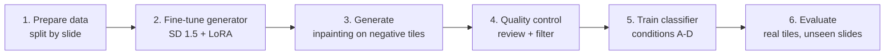

# PlaqueGuard: Synthetic Hard Negatives for Amyloid-β Plaque Detection

Generating realistic "look-alike" tiles (Stable Diffusion 1.5 + LoRA + inpainting) to reduce the false positives of a cored amyloid-β plaque classifier, especially when real hard negatives are scarce.

> **Status:** project proposal stage (week 5). Sections marked *(planned)* will be filled in as the work progresses. No results yet.

---

## 1. Motivation

Alzheimer's neuropathology relies on manual, semi-quantitative scoring of amyloid-β plaques on immunohistochemistry (IHC) slides (for example CERAD). Manual scoring is slow and varies between raters and labs. Automatic analysis could make large studies scalable and reproducible.

**Why cored plaques.** We focus on cored plaques (dense center) and leave out diffuse plaques and cerebral amyloid angiopathy (CAA, amyloid in vessel walls). Cored plaques are a close proxy of the neuritic plaques that CERAD counts (our stain shows only amyloid, so neuritic damage cannot be seen directly; proxy, not identical). CERAD does not count diffuse plaques, and CAA is a different problem. Restricting to cored also keeps the task clean: cored yes / no.

**What exists.**

- **Tang et al. 2019** is our base: a tile classifier and the public dataset we use.
- **Scalco et al. 2024** reuses Tang's classifier to count plaques in 131 slides. It does not test robustness to tissue artifacts or report false-positive rates.
- **PlaqueNet / DeepPlaque (2026)** classifies plaque types (diffuse, fibrillar, core) in fluorescence images and studies the cells around them. As far as we read, it has no background class and reports no analysis of false positives.
- **Related technique:** DADA (MICCAI 2025, polyps) synthesizes hard false positives for a detector; diffusion + LoRA has been used for medical image augmentation (2024-25). As far as we could survey, we did not find synthetic hard negatives applied to amyloid plaques, nor a study of how much they help when real hard negatives are scarce.

Our hypothesis (to be tested, not a published figure): real hard negatives are scarce and concentrated in a few slides, so classifiers do not see enough of them during training and still produce false positives on brown look-alikes (pigment, debris, vessel walls).

## 2. Problem statement

Given 256×256 px IHC tiles, train a classifier that identifies **cored** amyloid-β plaques with fewer false positives, measured as the **false-positive rate at 90% recall** on real tiles from unseen slides. This is tile-level classification, not object detection.

- **Input:** IHC tile, 256×256 px, 20x.
- **Output:** tile-level score, cored plaque yes / no. This is not a diagnosis of Alzheimer's.
- **Constraints:** the generator is trained only on training slides; synthetic data is used only in training; the test set is real tiles from unseen slides; diffuse plaques are kept out of training and the main metric (evaluated separately).

## 3. Visual abstract



*(A final figure will be added here.)*

## 4. Datasets

- **Tang et al. 2019**, amyloid-β IHC tiles, Zenodo [10.5281/zenodo.1470797](https://doi.org/10.5281/zenodo.1470797), license **CC BY 4.0**. 63 whole-slide images from 63 cases, 256×256 px tiles centered on plaque candidates, expert labels (cored, diffuse, CAA, negative).
- Splits provided by the authors: train 61,370 tiles (29 slides), validation 8,630 (4 slides), hold-out 10,873 (10 slides). No slide is shared between splits (verified).
- We use: cored plaques as positives (3,029 train tiles); pure, clean negatives (easy: random background; hard: brown look-alikes). Diffuse and CAA are not used for training.
- Known limitations: few clean negatives in the hold-out (~203), possible label noise, and a hard-negative filter that still mixes in empty tiles (being refined).

The dataset is **not** included in this repository. Please download it from Zenodo and cite Tang et al. 2019 (*Nat Commun*).

## 5. Augmentation and generation

- **Generator:** Stable Diffusion 1.5 fine-tuned with LoRA on real hard negatives from training slides only.
- **Inpainting:** a look-alike is painted on a negative tile; the label stays negative.
- **Quality control:** visual review of a sample, a real-vs-synthetic classifier, and filtering tiles that look like real plaques.
- **Classic augmentation** (flips, rotations, color jitter) is used as a separate control condition.

*(planned: generator validation with a small test before scaling up.)*

## 6. Input / output examples

*(planned)* Example real tiles (cored, diffuse, easy negative, brown look-alikes) and examples of generated tiles will be added here.

## 7. Models and pipelines

Two trained models: a fine-tuned image generator and a classifier (small CNN or ResNet18).

Training conditions:

| Condition | Training data |
|---|---|
| A | Real only (baseline) |
| B | A + classic augmentation |
| C | A + easy synthetic (control) |
| D | A + synthetic hard negatives (ours) |

Ablation: keep 5, 10, 25 and 100% of the real hard negatives. The classifier is held fixed across conditions, so any difference comes from the training data.

## 8. Training process and parameters

*(planned)* Hyperparameters, seeds, hardware and training time will be documented here.

## 9. Metrics

- **Primary:** false-positive rate at 90% recall, on real tiles from unseen slides. The 90% recall is an operating point, not a target.
- **Supporting:** AUPRC and AUROC. Accuracy is not used because of class imbalance.
- **Uncertainty:** several seeds and bootstrap confidence intervals.
- **Secondary:** fraction of diffuse-only tiles predicted as cored, with the threshold fixed at 90% recall.
- **Success criteria (fixed before running D):** D has a lower false-positive rate at 90% recall than both A and C, with non-overlapping intervals. We report the size of the gap; we do not promise a specific number. In the ablation (5, 10, 25 and 100% of real hard negatives) we plot how much of the gap synthetic data recovers. A null result will also be reported.

## 10. Results

*(planned)* No results yet.

## 11. Repository structure

```
.
├── README.md
├── slides/        # proposal slides (PPT and PDF)
├── notebooks/     # (planned) experiments
├── src/           # (planned) data prep, generation, training, evaluation
└── docs/          # (planned) figures and notes
```

## 12. Team members

- Lucas Boet
- Yerus Kanaw
- Yuval David

---

**References**

- Tang et al. 2019, *Nature Communications*. Dataset: Zenodo 10.5281/zenodo.1470797 (CC BY 4.0).
- Scalco et al. 2024, *Acta Neuropathologica Communications* 12:134.
- PlaqueNet / DeepPlaque, 2026, *EMBO Molecular Medicine*.
- DADA, MICCAI 2025 (hard false-positive synthesis for polyp detection).
- Mirra et al. 1994 (CERAD).
