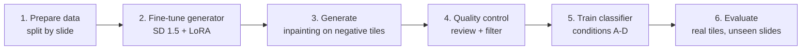

# Synthetic Hard Negatives for Amyloid-β Plaque Detection

Generating realistic "look-alike" tiles (Stable Diffusion 1.5 + LoRA + inpainting) to reduce the false positives of a cored amyloid-β plaque detector, especially when real hard negatives are scarce.

> **Status:** project proposal stage (week 5). Sections marked *(planned)* will be filled in as the work progresses. No results yet.

---

## 1. Motivation

Alzheimer's neuropathology relies on manual, semi-quantitative scoring of amyloid-β plaques on immunohistochemistry (IHC) slides (CERAD, Thal). Manual scoring is slow, coarse, lacks precise localization and varies between raters and labs. Automatic detectors exist (Tang et al. 2019, Wong et al. 2023), but they still produce false positives on brown look-alikes (pigment, debris, vessel walls).

Our hypothesis (to be tested, not a published figure): real hard negatives are scarce and concentrated in a few slides, so detectors do not see enough of them during training.

## 2. Problem statement

Given 256×256 px IHC tiles, train a classifier that detects **cored** amyloid-β plaques with fewer false positives, measured as the **false-positive rate at 90% recall** on real tiles from unseen slides.

- **Input:** IHC tile, 256×256 px, 20x.
- **Output:** tile-level score, cored plaque yes / no. This is not a diagnosis of Alzheimer's.
- **Constraints:** the generator is trained only on training slides; synthetic data is used only in training; the test set is real tiles from unseen slides; diffuse plaques are kept out of training and the main metric (evaluated separately).

## 3. Visual abstract



*(A final figure will be added here.)*

## 4. Datasets

- **Tang et al. 2019**, amyloid-β IHC tiles, Zenodo [10.5281/zenodo.1470797](https://doi.org/10.5281/zenodo.1470797), license **CC BY 4.0**. 63 whole-slide images from 63 cases, 256×256 px tiles centered on plaque candidates, expert labels (cored, diffuse, CAA, negative).
- Splits provided by the authors: train 61,370 tiles (29 slides), validation 8,630 (4 slides), hold-out 10,873 (10 slides). No slide is shared between splits (verified).
- We use: cored plaques as positives (3,029 train tiles); pure, clean negatives (easy: random background; hard: brown look-alikes). Diffuse and CAA are not used for training.
- Known limitations: few clean negatives in the hold-out (~203), possible label noise, and a hard-negative filter that still mixes in empty tiles (being refined).

The dataset is **not** included in this repository. Please download it from Zenodo and cite Tang et al. 2019 (*Nat Commun*).

## 5. Augmentation and generation

- **Generator:** Stable Diffusion 1.5 fine-tuned with LoRA on real hard negatives from training slides only.
- **Inpainting:** a look-alike is painted on a negative tile; the label stays negative.
- **Quality control:** visual review of a sample, a real-vs-synthetic classifier, and filtering tiles that look like real plaques.
- **Classic augmentation** (flips, rotations, color jitter) is used as a separate control condition.

*(planned: generator validation with a small test before scaling up.)*

## 6. Input / output examples

*(planned)* Example real tiles (cored, diffuse, easy negative, brown look-alikes) and examples of generated tiles will be added here.

## 7. Models and pipelines

Two trained models: a fine-tuned image generator and a classifier (small CNN or ResNet18).

Training conditions:

| Condition | Training data |
|---|---|
| A | Real only (baseline) |
| B | A + classic augmentation |
| C | A + easy synthetic (control) |
| D | A + synthetic hard negatives (ours) |

Ablation: keep 5, 10, 25 and 100% of the real hard negatives.

## 8. Training process and parameters

*(planned)* Hyperparameters, seeds, hardware and training time will be documented here.

## 9. Metrics

- **Primary:** false-positive rate at 90% recall, on real tiles from unseen slides.
- **Supporting:** AUPRC and AUROC. Accuracy is not used because of class imbalance.
- **Uncertainty:** several seeds and bootstrap confidence intervals.
- **Secondary:** fraction of diffuse-only tiles predicted as cored, with the threshold fixed at 90% recall.
- **Success criteria (fixed before training D):** D lowers the false-positive rate at 90% recall by at least 20% (relative) vs A and beats C with non-overlapping intervals; with only 5% of real hard negatives, D recovers at least half of the gap to 100%. A null result will also be reported.

## 10. Results

*(planned)* No results yet.

## 11. Repository structure

```
.
├── README.md
├── slides/        # proposal slides (PPT and PDF)
├── notebooks/     # (planned) experiments
├── src/           # (planned) data prep, generation, training, evaluation
└── docs/          # (planned) figures and notes
```

## 12. Team members

- Lucas Boet
- Yerus Kanaw
- Yuval David

---

**References**

- Tang et al. 2019, *Nature Communications*. Dataset: Zenodo 10.5281/zenodo.1470797 (CC BY 4.0).
- Wong et al. 2023, *Communications Biology*.
- Mirra et al. 1994 (CERAD).
